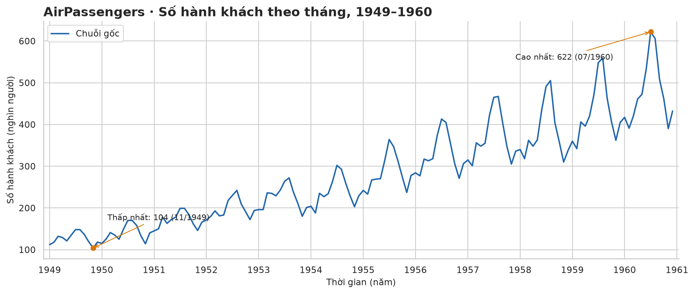
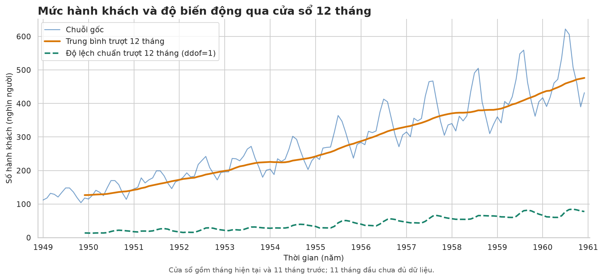
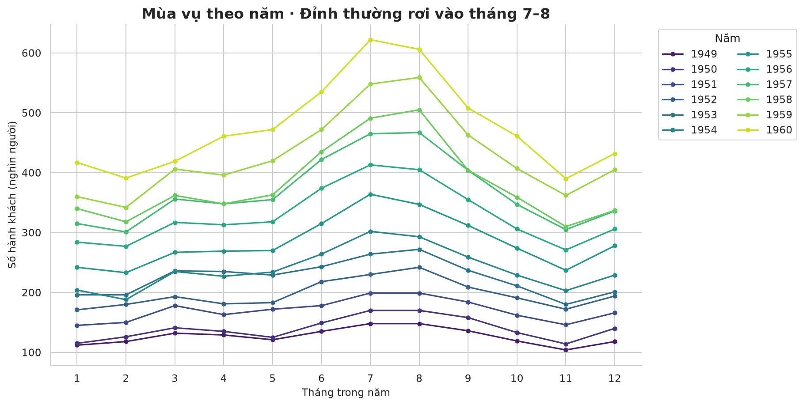
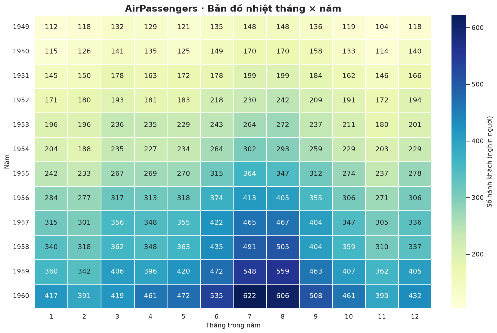
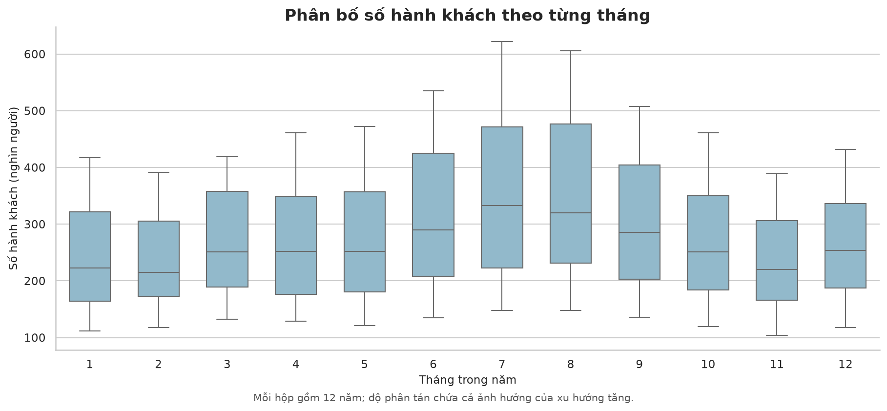

# Bài 5: Trực quan hóa chuỗi thời gian

**Dữ liệu:** AirPassengers, 144 quan sát tháng từ 01/1949 đến 12/1960; đơn vị: nghìn hành khách.

## Kết quả và nhận xét

1. Chuỗi có xu hướng tăng rõ: số hành khách trung bình tháng trong năm tăng từ 126,67 nghìn năm 1949 lên 476,17 nghìn năm 1960, khoảng 3,76 lần.
2. Seasonal plot cho thấy mùa vụ lặp lại theo năm; trung bình của tháng 7 và tháng 8 lần lượt là 351,33 và 351,08 nghìn, cao nhất trong 12 tháng.
3. Tháng 11 có trung bình thấp nhất (232,83 nghìn), kế đến là tháng 2 (235,00 nghìn); đây là so sánh trung bình qua 12 năm, không có nghĩa mọi năm cùng một tháng thấp nhất.
4. Khoảng cách đỉnh–đáy trong năm tăng từ 44 nghìn năm 1949 lên 232 nghìn năm 1960, cho thấy biên độ dao động mùa vụ tuyệt đối nhìn chung tăng cùng mức chuỗi.
5. Rolling std 12 tháng tăng từ 13,72 lên 77,74 nghìn khi so cửa sổ đầu và cuối, gợi ý độ biến động không ổn định theo thời gian, nhưng không tăng liên tục từng tháng.
6. Heatmap xác nhận mức hành khách cao hơn ở các năm cuối; cực đại toàn chuỗi là 622 nghìn vào 07/1960 và cực tiểu là 104 nghìn vào 11/1949.
7. Quan sát biểu đồ chưa thấy đỉnh đơn lẻ tách rõ khỏi dạng mùa vụ; giá trị 622 nghìn nằm trong đợt cao điểm tháng 7–8 năm 1960, và việc xác định outlier cần xét sai lệch so với xu hướng và mùa vụ.

## Hình minh họa

### Hình B5.1. Chuỗi theo thời gian

### Hình B5.2. Trung bình và độ lệch chuẩn trượt 12 tháng

### Hình B5.3. Mùa vụ theo năm

### Hình B5.4. Heatmap tháng × năm

### Hình B5.5. Boxplot theo tháng (bổ sung)

Boxplot gộp 12 năm cho từng tháng nên độ phân tán chứa cả tác động của xu hướng tăng; không dùng riêng biểu đồ này để khẳng định có hoặc không có outlier trong chuỗi thời gian.

## Nguồn

[AirPassengers CSV — kho dữ liệu jbrownlee/Datasets](https://raw.githubusercontent.com/jbrownlee/Datasets/master/airline-passengers.csv), tải ngày 20/10/2026. Các số liệu nhận xét được tính trực tiếp từ file CSV này.
