# Lab 2 Report — Time Series Analysis

## 1. Data description

AirPassengers contains 144 monthly international airline passenger counts from
January 1949 through December 1960, measured in thousands. It has no missing
observations; the mean is 280.3 thousand, the minimum is 104 thousand, and the
maximum is 622 thousand. The Melbourne daily minimum-temperature file contains
3,650 observations during 1981–1990. Reindexing to daily frequency reveals two
missing calendar dates: December 31, 1984 and December 31, 1988. The original
data files are kept in data/raw/.

## 2. ACF/PACF

The AirPassengers ACF decays slowly, from 0.948 at lag 1 to 0.337 at lag 36.
Seasonal peaks recur at lags 12, 24, and 36, with ACF values of 0.760, 0.532,
and 0.337. This indicates strong autocorrelation and annual seasonality. The
largest PACF coefficient is at lag 1 (0.948); the PACF coefficients at lags
12, 24, and 36 are smaller. The slow ACF decay and rising observed series are
consistent with trend and seasonality; the original series is not stationary
around a fixed level. The approximate 95% reference band is ±0.163 for n = 144.

| Lag (months) | ACF | PACF (Yule–Walker) |
|---:|---:|---:|
| 1 | 0.9480 | 0.9480 |
| 12 | 0.7604 | -0.1354 |
| 24 | 0.5322 | 0.0480 |
| 36 | 0.3370 | 0.0462 |

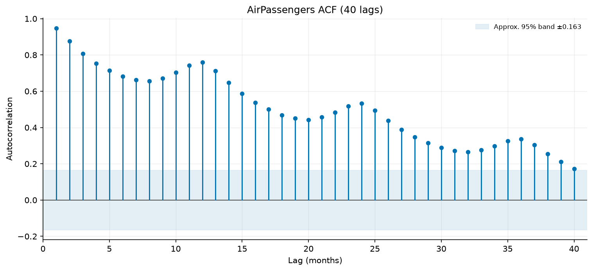

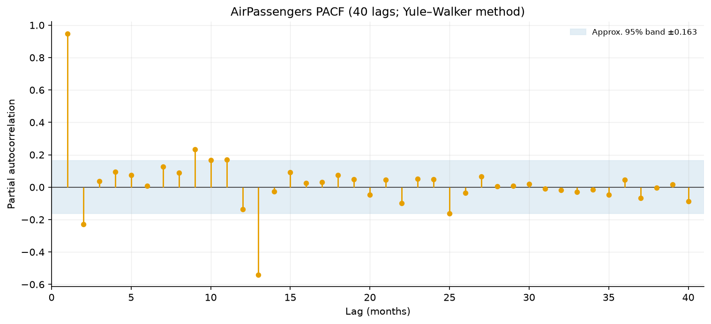

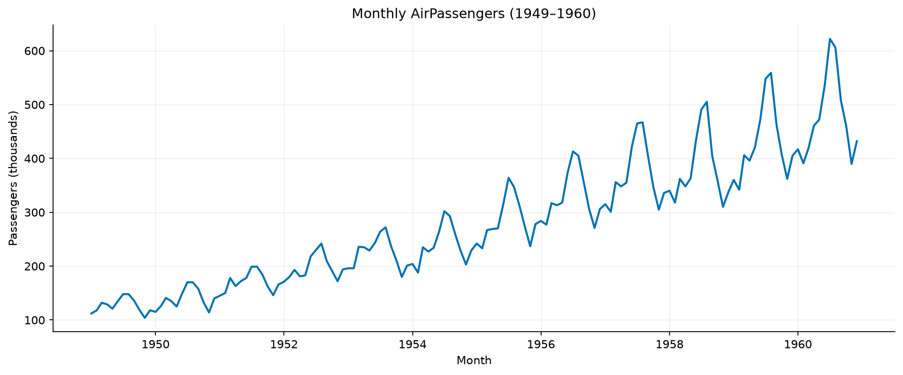

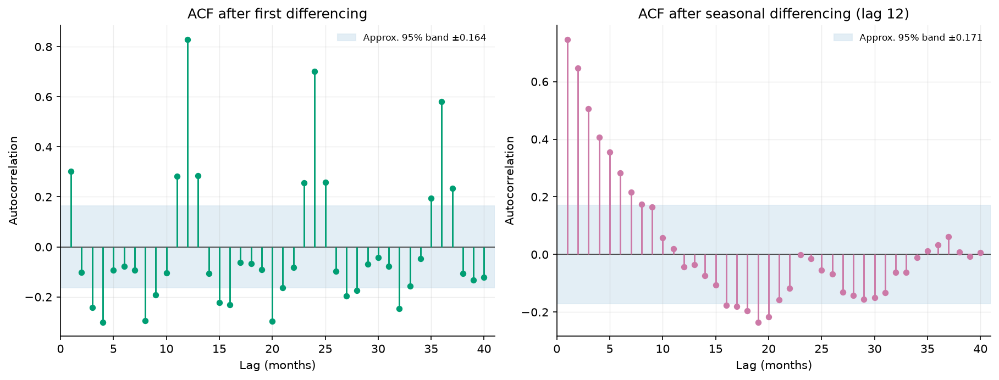

## 3. White-noise check

The simulated white-noise series contains 1,000 N(0, 1) values generated with
seed 42. One of its 40 ACF lags exceeds the approximate reference band of
±0.0620. The Ljung–Box p-values for white noise are 0.6571 at lag 10 and 0.7675
at lag 20; at the 5% level, we fail to reject the null of no autocorrelation
through those lags. For AirPassengers, p < 0.001 at both lags, providing strong
evidence of autocorrelation.

| Series | Lag | Ljung–Box Q | p-value |
|---|---:|---:|---:|
| White noise, n = 1,000 | 10 | 7.7108 | 0.6571 |
| White noise, n = 1,000 | 20 | 15.1552 | 0.7675 |
| AirPassengers, n = 144 | 10 | 857.0686 | < 0.001 |
| AirPassengers, n = 144 | 20 | 1,434.1489 | < 0.001 |

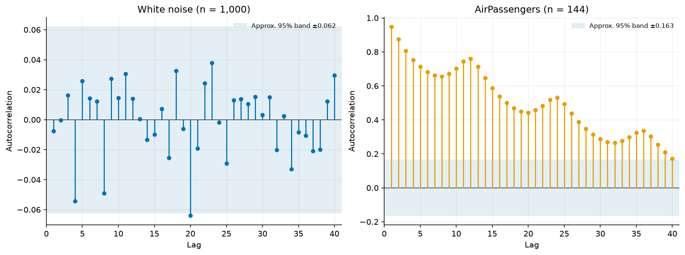

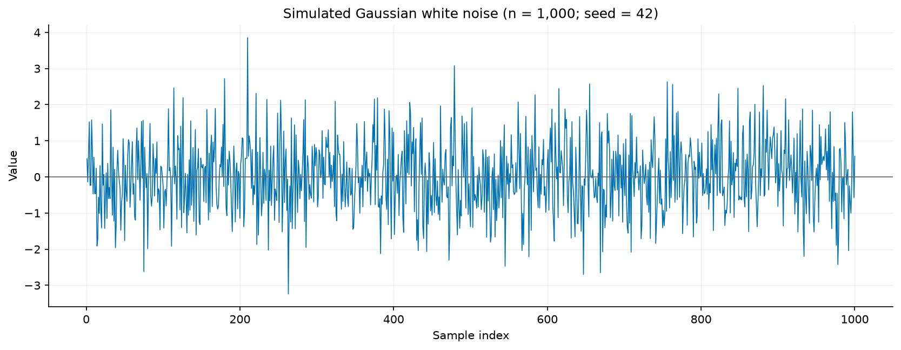

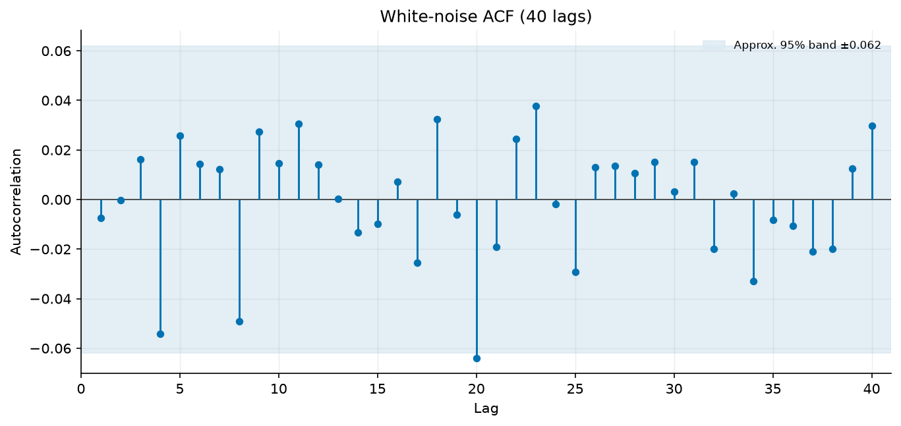

## 4. Time-series decomposition

Classical decomposition uses a multiplicative model with period 12. STL is
applied to log passenger counts with period 12. The STL trend strength is
0.996, and seasonal strength is 0.959; the mean seasonal component peaks in
July. These descriptive measures indicate that trend and seasonality account
for much of the series structure. However, Ljung–Box tests on the STL residuals
give p = 0.00026 at lag 10 and p = 0.00055 at lag 20, so the residuals retain
temporal dependence.

| STL metric | Value |
|---|---:|
| Trend strength | 0.9961 |
| Seasonal strength | 0.9593 |
| Month with the highest mean seasonal component | July |
| Residual Ljung–Box p-value, lag 10 | 0.000259 |
| Residual Ljung–Box p-value, lag 20 | 0.000549 |

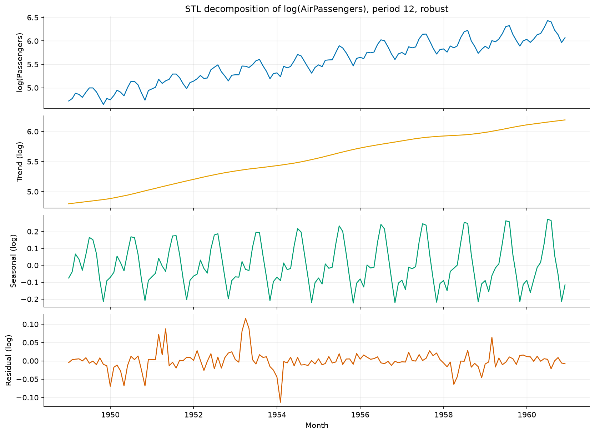

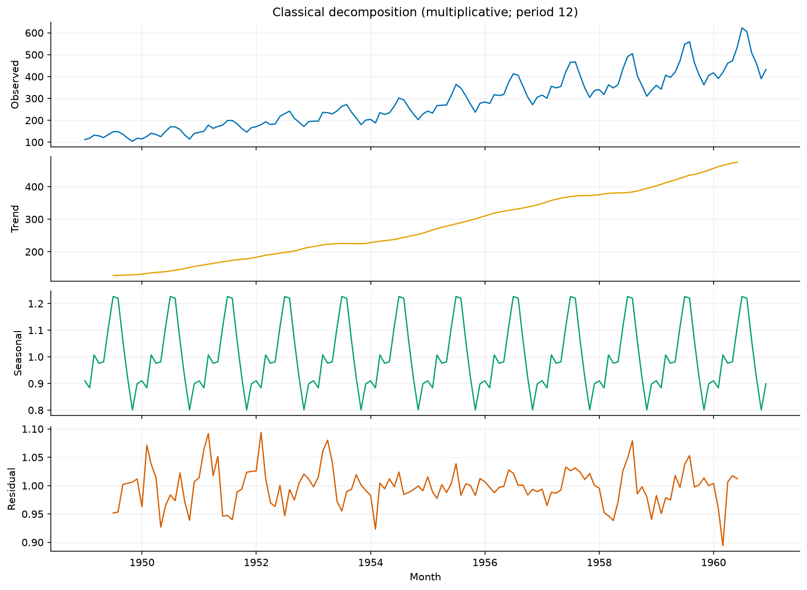

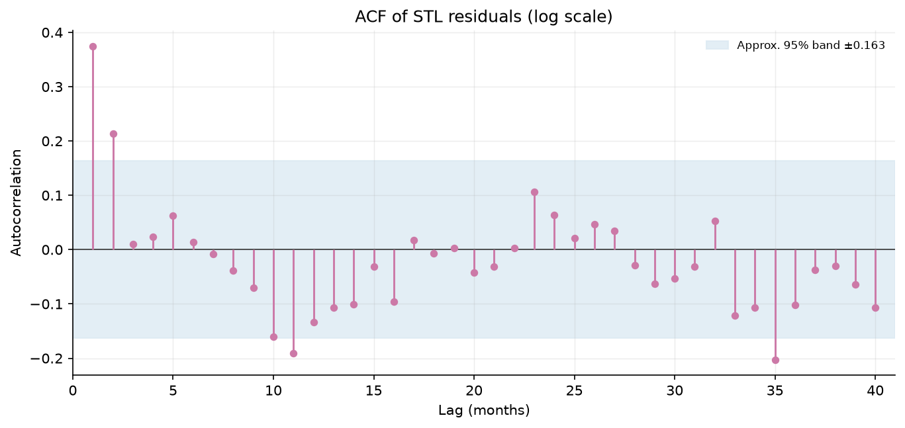

## 5. Data quality: missing values and outliers

### Missing values

Fifteen AirPassengers values were masked in a simulation (10.4% of 144 months).
Linear interpolation has an MAE of 24.47 thousand passengers, compared with
39.20 thousand for forward fill. For the 12 randomly selected points, MAE is
17.83 versus 31.00; for the consecutive three-month gap, it is 51.00 versus
72.00. Linear interpolation performs better in this experiment. The temperature
series has two missing calendar dates; linear interpolation estimates 14.85 °C
and 14.20 °C for those dates.

| Missing-value group | Forward-fill MAE | Linear-interpolation MAE |
|---|---:|---:|
| All 15 points | 39.20 | 24.47 |
| 12 random points | 31.00 | 17.83 |
| Consecutive three-month gap | 72.00 | 51.00 |

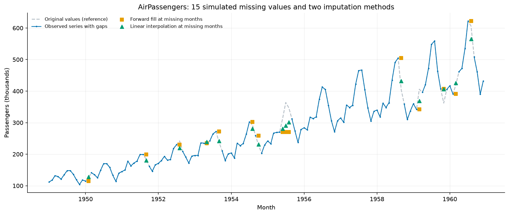

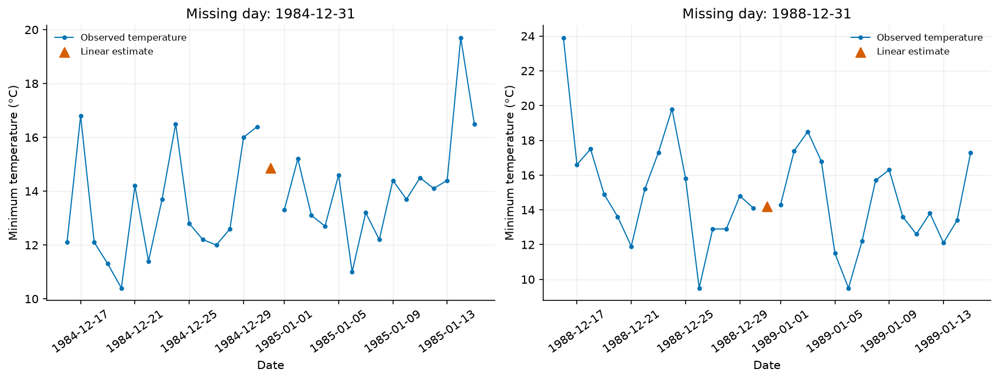

### Outliers

Z-score, IQR, and 12-month rolling thresholds flag no observations in the
original AirPassengers series. On the STL residuals, Z-score flags 5 points,
IQR flags 14, and both methods flag the same 5 points: May 1951, March 1953,
April 1953, May 1953, and February 1954. These consensus candidates are
interpolated in the cleaned output. They are threshold-based candidates, not
independently confirmed errors. In a separate synthetic check, both methods
detect all three deliberately injected large deviations.

| Method | Original series | STL residual |
|---|---:|---:|
| Z-score (absolute z > 3) | 0 | 5 |
| IQR | 0 | 14 |
| 12-month rolling threshold (3 SD) | 0 | — |

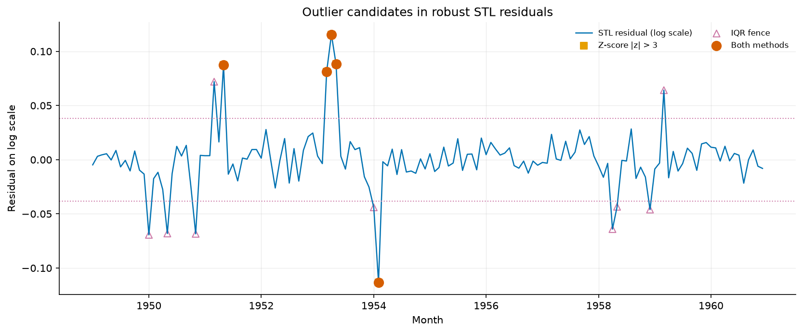

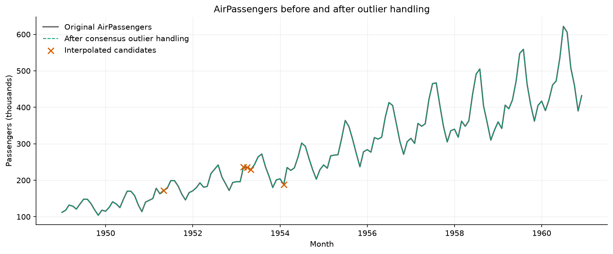

## 6. Visualization findings

Mean annual passenger counts rise from 126.7 thousand in 1949 to 476.2 thousand
in 1960. The highest monthly mean is in July (351.3 thousand), and the lowest
is in November (232.8 thousand). The seasonal plot and heatmap show a recurring
annual pattern. Mean 12-month rolling standard deviation rises from 16.54
thousand in the early part of the series to 71.71 thousand in the final 12
months. The increasing absolute variation alongside the level supports
considering a log transformation when building a model.

## 7. Conclusion and limitations

AirPassengers has an upward trend, 12-month seasonality, and strong
autocorrelation, so it has structure that can be explored with forecasting
methods. The series is non-stationary, and its variation increases with its
level; a log transform, ordinary or seasonal differencing, or a seasonal model
could be considered next. This lab does not fit a forecasting model or measure
holdout accuracy, so it does not establish which model forecasts best. The
analysis uses only 144 historical observations from 1949–1960; suitability for
current airline data would need reassessment with recent data and out-of-sample
evaluation.
